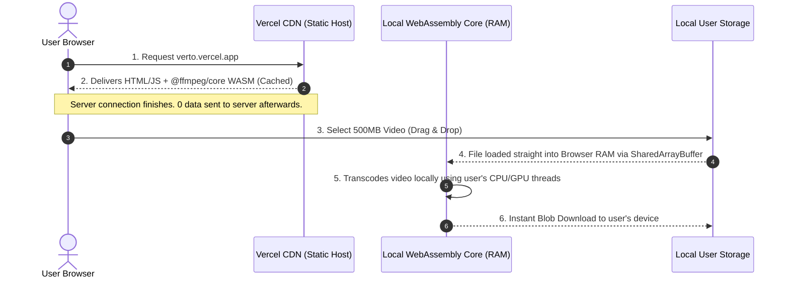

# VERTO: Web Deployment & Global Launch Blueprint
**Project:** `VERTO` (Client-Side WASM Media Transduction Engine)  
**Source Directory:** `C:\Users\enush\Desktop\ELYXIS\Verto`  
**Host Substrate:** Vercel (Edge / Static CDN)  
**Core Value Proposition:** 100% In-Browser Media Conversion. Zero Server Uploads. Zero File Size Limits. Absolute Privacy.

---

## 1. Technical Architecture & Client-Side Execution

### How It Works Without Server Uploads


### Critical Vercel Configuration: `vercel.json`
To allow multithreaded WASM execution in modern browsers, `SharedArrayBuffer` requires strict **Cross-Origin Isolation** headers.
When deploying to Vercel, the root `vercel.json` must be configured with:

```json
{
  "headers": [
    {
      "source": "/(.*)",
      "headers": [
        {
          "key": "Cross-Origin-Opener-Policy",
          "value": "same-origin"
        },
        {
          "key": "Cross-Origin-Embedder-Policy",
          "value": "require-corp"
        }
      ]
    }
  ]
}
```

---

## 2. SEO & Organic Discovery Strategy (How People Find It)

### Primary Problem with Existing Competitors:
- **CloudConvert, Zamzar, Convertio:**
  - Infested with pop-up ads and fake download buttons.
  - Hard limit of 2–5 free conversions per day.
  - Forces users to wait 5–10 minutes just uploading a large video to their cloud servers.
  - Sells subscriptions (\$9–\$25/month) just to remove wait times.
  - **Privacy Hazard:** Uploads sensitive medical recordings, confidential work footage, or private clips to third-party cloud disks.

### Target SEO Keywords & Positioning:
* **Primary Tagline:** *"The Private, Zero-Upload Media Converter for Your Browser."*
* **High-Intent Search Keywords:**
  - `client-side video converter no upload`
  - `private offline video converter web`
  - `convert large mp4 to mp3 without uploading`
  - `local wasm ffmpeg converter free`
  - `browser converter no file limit`

### Search Engine Meta Configuration:
* **Page Title:** `Verto — 100% Private, Local-First Browser Media Converter`
* **Meta Description:** `Convert video, audio, and images directly on your machine using in-browser WebAssembly. No server uploads, no file size limits, zero tracking, completely free.`

---

## 3. Monetization & Value Capture (Zero BS)

Since the entire engine runs on the user's hardware, **your hosting cost on Vercel is effectively \$0 / month**. You have zero backend compute bills.

### Revenue Streams:
1. **The "Buy Me a Coffee" / Tip Model:**
   - Place a sleek, non-intrusive tip link in the header or bottom corner:  
     *"Verto runs 100% locally on your machine with no ads. Support independent open-source development."*
   - Users who regularly convert sensitive or large files without dealing with CloudConvert paywalls happily tip \$3–\$10.
2. **Offline Desktop Pro Package (Optional Gumroad Link):**
   - Provide a pre-compiled Windows `.exe` / installer for people who want Verto pinned to their taskbar as a native offline app for \$3–\$5.
3. **Portfolio & Professional Proof of Work:**
   - Link `verto.vercel.app` on your CV and LinkedIn under **"High-Performance WebAssembly Software"**. Demonstrates production-grade systems architecture to European university labs and international HealthTech employers.

---

## 4. Step-by-Step Deployment Roadmap

### Phase 1: Local Codebase Audit & Web Isolation
- [x] Verify that `Machina/verto-core` builds cleanly via `npm run build`.
- [x] Confirm `@ffmpeg/core` binaries load either from local public assets or via secure unpkg/jsdelivr fallbacks.
- [x] Add `vercel.json` with `COOP` / `COEP` security headers for `SharedArrayBuffer` support.

### Phase 2: Landing Page & UX Polish
- [x] Add clear trust badges above the dropzone:
  - 🔒 *100% Private (Files never leave your computer)*
  - ⚡ *Instant Start (No waiting for file uploads)*
  - ♾️ *No File Size Caps*
- [x] Include format selector (MP4, MKV, WebM, MP3, WAV, AAC, GIF).
- [x] Add a subtle "Buy Me a Coffee / Sponsor" button in the footer.

### Phase 3: Deployment & Domain Setup
- [x] Push the clean web build to a private/public GitHub repository.
- [x] Link repository to Vercel (free tier).
- [x] Verify live domain deployment (e.g., `verto-converter.vercel.app` or custom domain).

### Phase 4: Organic Launch & Community Seeding
- [ ] **Reddit:** Share a direct post on `r/InternetIsBeautiful` and `r/webdev`:  
  *"I got sick of ad-filled converter sites that force you to upload 500MB files to their servers, so I built an open in-browser converter powered by WebAssembly FFmpeg. Zero uploads, zero tracking."*
- [ ] **Hacker News / ProductHunt:** Submit under the "Show HN" / Free Utility categories.
