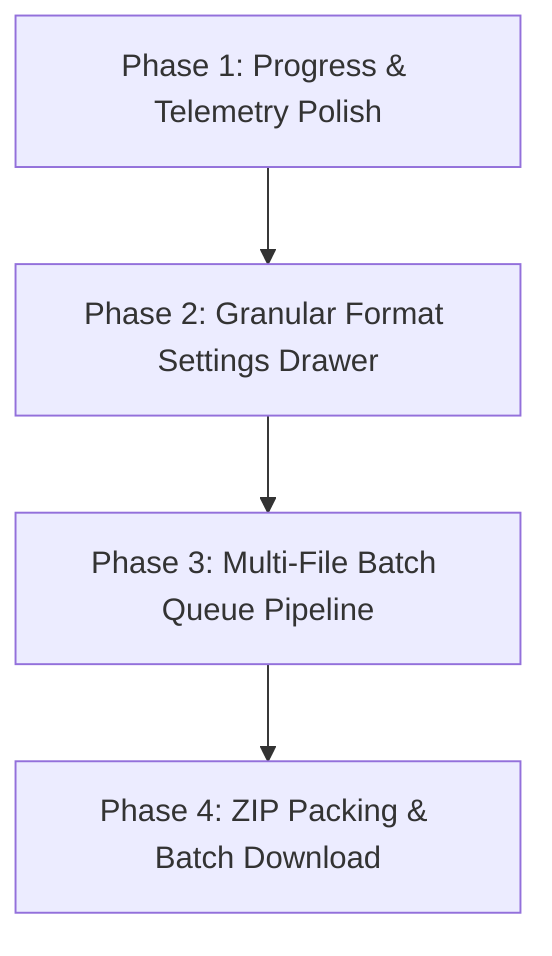

# VERTO // EVOLUTION BLUEPRINT (PLAN.md)
**Document Status:** Approved Roadmap  
**Source of Requirements:** Real-world community feedback (`r/SideProject` user testing)  
**Core Pillars:** Batch Processing & Queueing, Granular Format Controls, and High-Clarity Processing Telemetry.

---

## 1. Executive Summary & Community Signals

Feedback from early users highlighted three critical UX and feature demands:
1. **Batch Ingestion & Queue Pipeline:** Allow dropping multiple files or folders at once with sequential processing and a single "Download All (ZIP)" or individual download queue.
2. **Granular Format Tuning (Drawer):** Allow power users to tweak ProRes profiles (Proxy to 4444), MP4 CRF/presets, audio bitrates, and resolution scaling without cluttering the one-click experience.
3. **High-Clarity Progress HUD:** Ensure users on low-spec devices never think the browser tab froze by surfacing elapsed time, estimated remaining time, active pass/frame counters, and engine log pulses.

---

## 2. Technical Architecture & Feature Specifications

### 2.1 Pillar A: Multi-File Batch Queue Pipeline
*Current State:* Single-file state (`currentFile`), immediately blocking the input zone.  
*Target State:* File array state (`fileQueue: Array<{ id, file, status, progress, outputBlob, error }>`).

* **Queue Lifecycle:**
  1. **Intake:** User drops 1 to 50 files (or a folder).
  2. **Staging Table:** List displaying filename, size, chosen target format, status (`queued`, `transcoding`, `complete`, `failed`), and progress bar.
  3. **Sequential WASM Execution:** To prevent browser memory exhaustion (OOM), files transcode **one by one** in a FIFO queue.
  4. **Memory Hygiene:** After each file finishes, its input and output files are detached from FFmpeg's virtual filesystem (`FS.unlink`), and the output is converted to an object URL.
  5. **Export:** Individual download buttons + "Download All as ZIP" (via lightweight JSZip or sequential download triggers).

### 2.2 Pillar B: Parameterized Format Controls (Settings Drawer)
*Current State:* Hardcoded arrays in `matrix.js`.  
*Target State:* Default fallback + dynamic flag builder.

* **Video Controls:**
  - **Resolution Scale:** `Original (Source)` | `1080p` | `720p` | `480p` (`-vf scale=-2:720`)
  - **Speed / Efficiency Preset:** `ultrafast` (default) | `veryfast` | `medium`
  - **Quality (CRF):** Slider from 18 (near lossless) to 35 (compressed). Default: 23.
  - **ProRes Profiles (MOV):** Proxy (0), LT (1), Standard 422 (2, default), HQ (3).
  - **Audio Strip:** Checkbox to remove audio track (`-an`).
* **Audio Controls:**
  - **Bitrate:** `128k`, `192k`, `256k`, `320k`.
  - **Channels:** Stereo (default) | Mono downmix (`-ac 1`).
  - **Sample Rate:** `44.1 kHz`, `48.0 kHz`.
* **Image / GIF Controls:**
  - **GIF Framerate:** 10 fps, 15 fps (default), 24 fps, 30 fps.
  - **GIF Width:** 320px, 480px (default), 640px, Source.

### 2.3 Pillar C: Telemetry & Progress Indicator Polish
*Current State:* Single percentage circular SVG. Long video transcodes can make users think the tab is stuck.  
*Target State:* Real-time active telemetry pulse.

* **Active Frame / Speed HUD:** Surface FFmpeg stdout stats directly in the HUD:
  - `time=00:01:23.45` (Current position)
  - `speed=3.2x` (Transcoding rate relative to real time)
  - `fps=45` (Current rendering throughput)
* **ETA Calculation:** Dynamically project remaining time based on input duration vs current elapsed position.
* **Freeze-Guard Animation:** Sub-second pulsating heartbeat indicator ensuring the user visually confirms the Web Worker is alive and crunching.

---

## 3. Implementation Phasing

### Phase 1: High-Clarity Progress HUD (Immediate Win)
- Extract `time`, `fps`, and `speed` metrics from `ffmpeg.on('log')`.
- Display live throughput and elapsed time beneath the circular progress wheel.
- Add an animated pulse line so users on slow machines know the thread is healthy.

### Phase 2: Format Tuning Drawer (Community Request)
- Refactor `matrix.js` into modular argument generator functions.
- Create collapsible `<TuneParameters />` drawer in `App.jsx`.
- Implement format-specific sliders and dropdowns with instant fallback defaults.

### Phase 3: Multi-File Batch Queue Engine
- Migrate `App.jsx` state from single `currentFile` to an iterable `queue`.
- Build the batch queue HUD table showing files, per-file status, and format selection.
- Implement sequential asynchronous execution loop with proper WASM RAM cleanup.

### Phase 4: Batch Export & ZIP Integration
- Add "Download All" bundle mechanism.
- Verify memory stability across 1GB+ multi-file test suites.

---

## 4. Verification & Guardrails

* **WASM Memory Ceiling:** Monitor that multiple consecutive jobs do not leak memory into the browser tab (explicit `FS.unlink` and garbage collection).
* **Cross-Origin Isolation:** Ensure no external libraries violate `COOP`/`COEP` security headers.
* **Zero-Upload Guarantee:** All operations strictly preserve local execution with zero network egress.
