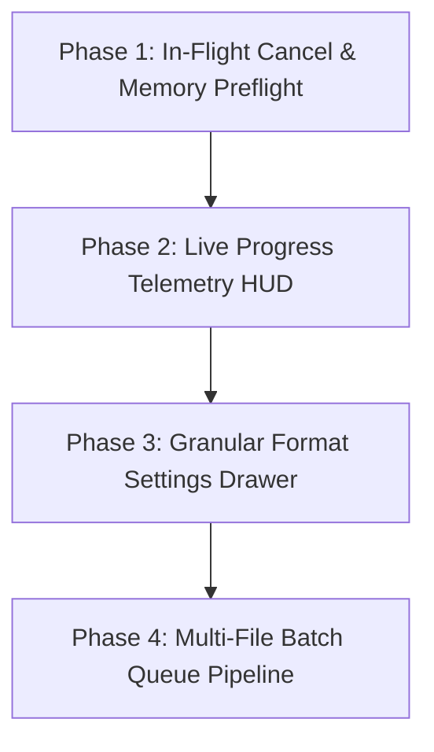

# VERTO // REVISED SPECIFICATION & ROADMAP (PLAN.md)
**Status:** Approved Architectural Blueprint  
**Origin:** Live Reddit Community User Testing (`r/SideProject`, `r/WebApps`, `r/IMadeThis`)  
**Core Directives:**
1. Clean Conversion Abortion / In-Flight Cancellation (without reloading the page).
2. Browser 2GB WASM Memory Safety Guardrails & Large-File Warnings.
3. Enhanced Multi-File Batch Queue Pipeline.
4. Granular Format Controls (ProRes Profiles, CRF Sliders, Audio Bitrates).
5. Live Processing Telemetry (Speed/FPS/Time Elapsed).

---

## 1. Direct Analysis of Community Inputs

### User A: `u/umit_dogan` (`r/SideProject`)
> *"Can I cancel a large conversion without reloading the tab? Keeping the selected file and conversion settings after cancellation would make it easier to retry at a lower resolution."*
* **Architecture Solution:** Add an active `Abort / Cancel Transcode` mechanism (`ffmpeg.terminate()` or abort signal) that safely resets the state machine back to `idle`, cleans up memory, but preserves `currentFile` and `selectedFormat` so the user can quickly tweak settings and restart.

### User B: `u/coconut_paddy_Kerala` (`r/WebApps`)
> *"I remember it can't convert video files. Is it true now?"*
* **Architecture Solution:** Affirm full multi-codec video capability (MP4 H.264/H.265, MKV, WebM VP9, MOV ProRes, AVI, GIF) powered by modern `@ffmpeg/core`.

### User C: `u/Total-Reasonable` (`r/IMadeThis`)
> *"No file size limits is only true up to the browser's memory ceiling... If you're using ffmpeg.wasm, the single-threaded build and 2GB wasm memory cap will crash on big videos... Have you tested a 3-4GB file on a phone yet? I'd surface a clear warning or a chunked fallback rather than letting it fail silently."*
* **Architecture Solution:** This user has deep technical knowledge of WebAssembly constraints. 32-bit WASM pointers enforce a hard **2GB addressable memory limit per instance**.
  - Surface a proactive RAM & file-size preflight warning if `file.size > 1.5GB` (desktop) or `> 500MB` (mobile).
  - Explicitly document that `COOP`/`COEP` headers are already enabled for `SharedArrayBuffer` multithreading.
  - Gracefully catch WASM OOM (Out Of Memory) errors and display a clear guidance banner rather than letting the tab silently lock up.

---

## 2. Core Pillars & Feature Breakdown

### Pillar 1: In-Flight Cancellation & State Preservation
* **Mechanism:**
  - Introduce an `Abort Synthesis` button during the `processing` state.
  - On trigger: invoke `ffmpeg.terminate()`, re-initialize `loadFundamentum()`, but **preserve** `currentFile` and UI format selection.
  - Returns state directly to `idle` with an alert: `Transduction Aborted. Ready to re-configure.`

### Pillar 2: Browser WASM Memory Preflight & Safety Guard
* **Memory Preflight Check:**
  - Before writing files into WASM memory via `ffmpeg.writeFile`, calculate available memory ceiling (`navigator.deviceMemory`).
  - If file size exceeds 1.5GB: Display an informational warning:
    > *"Notice: Files exceeding 1.5GB push browser WebAssembly memory limits (2GB 32-bit ceiling). If your browser halts, retry at a lower resolution or bitrate."*
* **OOM Error Trap:** Catch `RuntimeError: memory access out of bounds` or worker termination and present an actionable fix (e.g. "Select a lower resolution or ultrafast preset").

### Pillar 3: Multi-File Batch Queue Pipeline
* **Iterable Queue:** State management to intake multiple files via drag-and-drop.
* **Sequential FIFO Execution:** Convert files one by one to prevent multiple parallel WASM allocations from triggering instant browser tab crashes.
* **Memory Reclamation:** Explicit virtual file deletion (`ffmpeg.deleteFile`) immediately upon completion of each queue item.
* **Batch Downloader:** Individual download triggers per item + "Download All" option.

### Pillar 4: Granular Format Configuration Drawer
* **Collapsible "Tune Parameters" HUD:**
  - **Video:** Resolution scaling (1080p, 720p, 480p), Quality CRF (18–35), Speed Presets (`ultrafast`, `medium`), ProRes Profiles (Proxy `0`, LT `1`, Standard `2`, HQ `3`), and Audio Strip (`-an`).
  - **Audio:** Bitrates (128k–320k), Stereo vs Mono (`-ac 1`), and Sample Rates (44.1k/48k).
  - **GIF:** Framerate (10–30fps) and width scaling.

### Pillar 5: Real-Time Telemetry & Progress HUD
* **Live Engine Pulse:** Parse `ffmpeg.on('log')` to extract `time=`, `speed=`, and `fps=`.
* Surface active throughput beneath the circular progress wheel to eliminate user anxiety over frozen tabs.

---

## 3. Phased Implementation Strategy

### Phase 1: In-Flight Cancel & Memory Preflight (Immediate Priority)
- Add `Abort / Cancel` button in `appState === 'processing'`.
- Implement non-destructive reset keeping `currentFile` and selected options in memory.
- Add file size preflight guard warning for files `> 1.5GB`.

### Phase 2: Live Progress Telemetry HUD
- Parse stream log values for `speed` and `time`.
- Display live stats below the progress circle.

### Phase 3: Format Parameter Tuning Drawer
- Refactor `matrix.js` command closures to accept dynamic option parameters.
- Add collapsible settings drawer for ProRes profiles, CRF, and bitrates.

### Phase 4: Multi-File Batch Processing
- Migrate from single file state to queue array.
- Sequential asynchronous worker loop with per-item cleanup.
