# Verto

> **100% Private, In-Browser Media Converter**  
> Convert video, audio, and images directly in your browser using WebAssembly. No server uploads. No file size limits. Zero tracking.

---

### [🚀 Open Live Web App](https://verto-eta.vercel.app)

---

## Why Verto?

Most online file converters force you to upload large 500MB videos to third-party servers, queue you behind paid subscription paywalls, or bombard you with sketchy download buttons.

**Verto works completely differently:**
* **Zero Server Uploads:** Your files **never leave your device**. The engine runs inside your browser tab.
* **No File Size Caps:** Transcoding runs in your device's RAM using WebAssembly threads.
* **100% Private:** Perfect for confidential work footage, private audio, and personal files.
* **Completely Free:** No paywalls, no account creation, no ads.

---

## Supported Formats

| Category | Formats |
| :--- | :--- |
| **Video** | MP4 (H.264 / H.265), MKV, WebM (VP9), MOV (ProRes), AVI, GIF, FLV |
| **Audio** | MP3 (320k), WAV (Lossless), FLAC, M4A (AAC), OGG, AIFF, AC3 |
| **Image** | PNG, JPG, WebP, AVIF, ICO, BMP, TIFF, TGA |

---

## Architecture Overview

```mermaid
flowchart LR
    A[Local File on Disk] -->|Drag & Drop| B[Browser RAM]
    B -->|Transcode via WebAssembly| C[Local FFmpeg WASM Core]
    C -->|Instant Direct Download| D[Converted File]
    
    style B fill:#0f172a,stroke:#38bdf8,stroke-width:2px
    style C fill:#0f172a,stroke:#22c55e,stroke-width:2px
```

Verto serves the frontend and compiled WASM binaries via Vercel Edge CDN with strict Cross-Origin Isolation (`COOP: same-origin`, `COEP: require-corp`) to unlock multithreaded `SharedArrayBuffer` hardware execution on your device.

---

## Support & Open Source

Verto is built and maintained as an independent local-first utility.  
If it saved you time or a cloud subscription, consider supporting development:

☕ **[Support on Ko-fi](https://ko-fi.com/elyxis)**

---

© 2026 ELYXIS. All rights reserved.
