# Verto

> **100% Private, In-Browser Media Converter**  
> Convert video, audio, and images directly in your browser using WebAssembly. No server uploads. No file size limits. Zero tracking.

---

### [🚀 Open Live Web App](https://verto.elyxis.vercel.app/) • [🌐 Elyxis Portal](https://elyxis.pages.dev/)

---

## Why Verto?

> ⚡ **Local Hardware Performance:** Because Verto runs 100% client-side via in-browser WebAssembly without offloading files to remote server farms, transcode speeds depend directly on your device's CPU and RAM.

Most online file converters force you to upload large 500MB videos to third-party servers, queue you behind paid subscription paywalls, or bombard you with sketchy download buttons.

**Verto works completely differently:**
* **Zero Server Uploads:** Your files **never leave your device**. The engine runs inside your browser tab.
* **Smart Stream Copy (~100x Faster):** When switching containers between compatible codecs (e.g. MKV ⇄ MP4), Verto remuxes instantly using `-c copy` without re-encoding video frames.
* **Client-Side RAM Processing:** Transcoding runs in your device's browser memory via WebAssembly (subject to the browser's 2.0GB 32-bit WASM memory ceiling for single-instance allocations).
* **In-Flight Cancellation:** Cancel running conversions with one click without reloading the tab, preserving your staged queue and format settings.
* **100% Private:** Perfect for confidential work footage, private audio, and personal files.
* **Completely Free:** No paywalls, no account creation, no ads.

---

## Supported Formats

| Category | Formats |
| :--- | :--- |
| **Video** | MP4 (H.264 / H.265), MKV, WebM (VP9), MOV (ProRes), AVI, GIF, FLV |
| **Audio** | MP3 (320k), WAV (Lossless), FLAC, M4A (AAC), OGG, AIFF, AC3 |
| **Image** | PNG, JPG, WebP, AVIF, ICO, BMP, TIFF, TGA |

---

## Architecture Overview

```mermaid
flowchart LR
    A[Local File on Disk] -->|Drag & Drop| B[Browser RAM]
    B -->|Transcode via WebAssembly| C[Local FFmpeg WASM Core]
    C -->|Instant Direct Download| D[Converted File]
    
    style B fill:#0f172a,stroke:#38bdf8,stroke-width:2px
    style C fill:#0f172a,stroke:#22c55e,stroke-width:2px
```

Verto serves the frontend and compiled WASM binaries via Vercel Edge CDN with strict Cross-Origin Isolation (`COOP: same-origin`, `COEP: require-corp`) to unlock multithreaded `SharedArrayBuffer` hardware execution on your device.

---

## License & Usage

Distributed under the **GNU General Public License v3.0 (GPL-3.0)**.  
You are free to inspect, audit, and run the code. Proprietary closed-source forks and commercial redistribution without reciprocal open-sourcing are strictly prohibited under the terms of the GPL-3.0 license.

---

## Support & Ecosystem

Verto is an open-source project within the Elyxis ecosystem.  
Explore more independent, privacy-first software at the main portal:

🌐 **[Elyxis Central Portal](https://elyxis.pages.dev/)**  
☕ **[Support on Ko-fi](https://ko-fi.com/elyxis)**

---

© 2026 ELYXIS. All rights reserved. Licensed under GPL-3.0.
